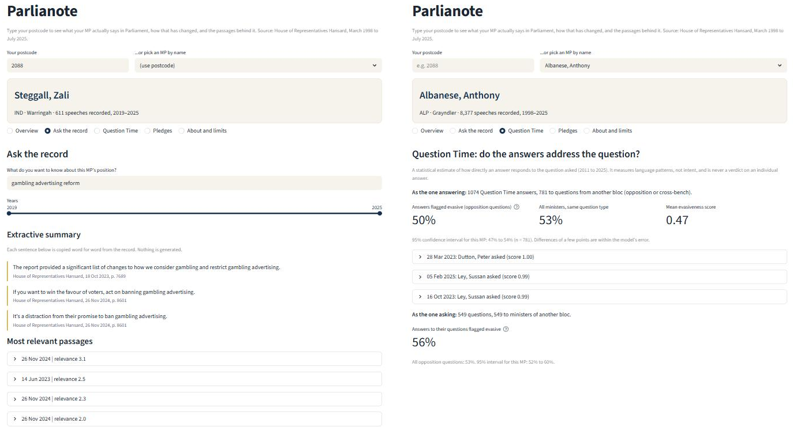

# Parlianote

**What your MP actually says in Parliament, with the source for every quote.**

Type your postcode to see your local MP (Member of Parliament), what they talk about, how that has changed over the years, and the exact words they used, each with the date and page in the official record. Or skip the postcode and search every MP at once: type a topic and see who spoke about it.

Built for *36118 Applied Natural Language Processing* (UTS) by Group 11, Team Phoenix.



## What you can do

| Screen | What it does |
|---|---|
| **Find my MP** | Postcode (or MP name) to the MP, then five views: Overview, Ask the record, Question Time, Promises, About and limits |
| **Search all MPs** | Type a topic or question; see who spoke about it, three key sentences with their speaker, and the passages behind them |
| **Overview** | Speeches per year, the subjects an MP talks about, and how that mix changed over time |
| **Ask the record** | Search one MP's speeches; compare their early and late wording; download the results as CSV |
| **Question Time** | A rough estimate of how directly ministers answer questions from the other side, with a confidence range |
| **Promises** | Sentences where a minister says "we will ...", split into specific (a number, date or amount) and general |
| **AI short answer** (optional) | An AI reads only the best passages and writes a short answer that cites them |

If a search finds nothing that clearly matches, the app says so plainly and explains that this does **not** prove nobody spoke about it.

## Quick start

You need Python 3.10 or newer (developed and tested on 3.13).

```bash
pip install -r requirements.txt
python scripts/download_data.py          # downloads about 600 MB of public data into data/
```

Then build the app's data once (see [Rebuilding the data](#rebuilding-the-data)) and start the app:

```bash
streamlit run app/app.py                 # or double-click run_app.bat on Windows
```

Open <http://localhost:8501>. The first search takes about 15 seconds while the language models load; after that, a search takes 1 to 2 seconds. Links such as `http://localhost:8501/?postcode=2088` open a screen directly, and the address bar updates as you search so you can share a result.

### Optional: AI-written answers

The app works fully without this. To add the short AI answer:

1. Copy `.env.example` to `.env`.
2. Paste your key after `OPENAI_API_KEY=` (or use `ANTHROPIC_API_KEY`, or run [Ollama](https://ollama.com) locally for a free option).
3. Restart the app. The sidebar shows whether AI answers are on.

The AI only sees the passages the search found and must cite them. Every answer is checked automatically (citations must exist and every figure must appear in the cited passages), but AI can still make mistakes. **`.env` holds your secret key: it is git-ignored, so never commit or share it.**

## How it works

```
Hansard 1998-2025 (648k rows)
   |  clean: keep real MP speeches (370,861)
   +-- postcode -> electorate -> MP         open postcode list, newest speaker = current MP
   +-- topics over time                     LDA topic model, 10 subjects
   +-- search (one MP or everyone)          keyword match (BM25 / TF-IDF) -> cross-encoder re-reads the best -> verbatim sentences
   +-- Question Time (2011-2025)            pair each question with its answer -> directness score; pledge finder
                          |
                    Streamlit web app  (+ optional AI answer from the retrieved passages only)
```

Design choices worth knowing:

- **Nothing is made up.** Key sentences are copied from the record. The optional AI answer is limited to the retrieved passages and fact-checked against them.
- **Uncertainty is shown, not hidden.** Directness scores come with a 95% range and are only compared on questions from the other side, because questions from the minister's own side are almost always answered directly.
- **It runs on a normal laptop** with no paid service required.

## Project layout

```
app/app.py              entry point: decides which screen to show
src/ui/                 the web app's building blocks
    config.py             settings and shared wording
    data.py               cached data and model loading
    search.py             cleans the user's query; searches one MP
    components.py         cards, buttons, quote boxes, AI answer box
    views.py              one function per screen
src/                    the analysis pipeline (pairing, features, models, evaluation, retrieval, AI answer)
tests/                  automatic checks (see below)
notebooks/              the phase-1 analysis notebook
report/                 the technical report (Word and PDF) and the scripts that build it
docs/                   the team insights document
data/                   downloaded data, plus the small hand-labelled sets the report relies on
results/                evaluation tables, figures and logs
team_labelling/         sheet for independent annotation (to measure agreement between labellers)
scripts/download_data.py   fetches the public datasets
```

## Rebuilding the data

`app/data/` and `models/` are too large for GitHub, so they are built locally. After `python scripts/download_data.py`, run from the project root, in this order:

```bash
python -m src.build_pairs                # pair each Question Time question with its answer (16,256 pairs)
python -m src.build_label_features       # features for the 120 hand-labelled pairs
python -m src.train_lda                  # topic model, about 10 minutes
python -m src.score_pairs                # score every pair, about 1 hour on CPU
python -m src.rescore                    # apply the final friendly-question rule to those scores
python -m src.prepare_app_data           # tag every speech with a topic and write app/data/, about 10 minutes
python -m src.global_search build        # index every speech for "Search all MPs", about 5 minutes
```

Evaluation scripts for the report (`src.make_figures`, `src.run_retrieval_eval`, `src.run_commitment_eval`, `src.summarise_scores`) are described in Appendix A of the report.

## Tests

```bash
python tests/run_all.py          # everything, a few minutes
python tests/run_all.py --fast   # quick offline checks only
```

About 100 automatic checks cover: political-bloc and pledge rules, query cleaning, the "no clear match" cut-offs, citations and CSV export, the AI-answer safety checks (using fake model replies, so no key or network is needed), and the whole app driven with odd inputs (bad postcodes, empty or hostile text, very long queries, non-English text, an MP with almost no speeches, every screen).

## Data and credits

- **Hansard:** Katz, L., & Alexander, R. (2025). *A new, comprehensive database of all proceedings of the Australian Parliamentary Debates (1998-2025)*. Zenodo. <https://doi.org/10.5281/zenodo.17351233> (CC BY 4.0).
- **Postcodes to electorates:** Matthew Proctor, <https://www.matthewproctor.com/australian_postcodes>. PO-box and business-only ranges are removed.

## Limitations and responsible use

- House of Representatives only, March 1998 to July 2025. The newest speaker for an area is treated as its MP, so seats that changed hands at the 2025 election need checking.
- The directness score is **rough**: among questions from the other side it separates "not direct" from the rest about 68% of the time (guessing gives 58%). It was labelled by a single annotator and has not been independently validated. It describes how an answer is worded, not anyone's intent, and it must never be used to rank or judge individuals.
- Question and answer labels in the source data are only reliable from 2011.
- Subject names are our reading of an automatic grouping and can be wrong.
- This is a student project and is not affiliated with, or endorsed by, the Parliament of Australia. Always check quotes against the [official record](https://www.aph.gov.au/Parliamentary_Business/Hansard).

## Team

Krishna Kumar Thirugnanavel, Sidharth Joly, Brian Shimmer, Malavika Rajesh, Prathamesh Nemade, Milad Kianfar.
