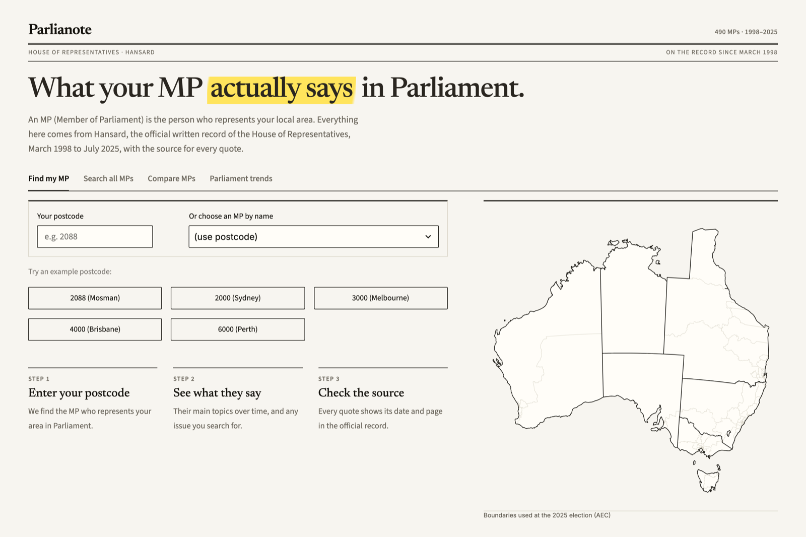
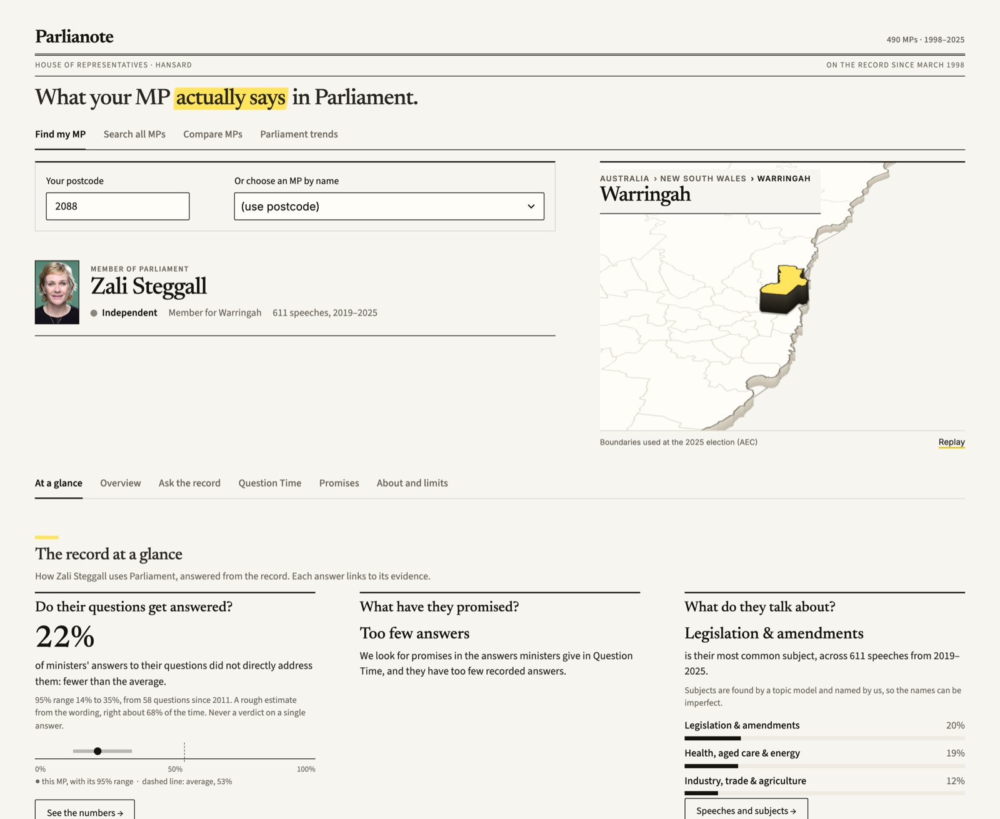

# Parlianote

**What your MP actually says in Parliament, with the source for every quote.**

Type your postcode to see your local MP (Member of Parliament), what they talk about, how that has changed over the years, and the exact words they used, each with the date and page in the official record. Or skip the postcode and search every MP at once: type a topic and see who spoke about it.

Built for *36118 Applied Natural Language Processing* (UTS) by Group 11, Team Phoenix.

Repository: <https://github.com/krishnakumar-devx/parlianote>



## What you can do

| Screen | What it does |
|---|---|
| **Find my MP** | Postcode (or MP name) to the MP, with their official photo and a map where their state lifts off the page and then their seat rises out of it (choose another MP and the map travels there, tracing the route). Six views follow, listed below. Before anyone is chosen, **On this day** shows a sentence spoken on today's date in an earlier year (or the nearest sitting day), picked to make sense on its own and to avoid party politics |
| **Search all MPs** | Type a topic or question; see who spoke about it, three key sentences with their speaker, and the passages behind them |
| **Compare MPs** | Two MPs side by side: both seats on one map, the subjects each talks about, and what each said on the same question |
| **Parliament trends** | How the subjects of the whole House changed from 1998 to 2025 (optionally by side of politics), and Question Time directness across ministers with 95% ranges; below it, "Is the model fair?": the two sides compared, agreement with human labellers, accuracy, and what the estimate cannot tell you |



For each MP:

| View | What it shows |
|---|---|
| **At a glance** | The first view: the poster's questions answered in plain words (do they answer the question, against the average minister; what have they promised, with the most checkable promise; what do they talk about), each with its evidence one click away |
| **Overview** | Speeches per year, the subjects they talk about, and how their focus changed: one row per subject across the years, with the year each one peaked |
| **Ask the record** | Search one MP's speeches; compare their early and late wording; download the results as CSV |
| **Question Time** | A rough estimate of how directly ministers answer questions from the other side, with a confidence range; each example exchange shades the answer sentence by sentence, showing where (or whether) it responds to the question |
| **Promises** | Sentences where a minister says "we will ...", split into specific (a number, date or amount) and general; the most checkable come first, questions and cut-off sentences are left out, and the pledge and its numbers are highlighted |
| **About and limits** | What the tool is, how it works and what to keep in mind, in plain language |
| **AI short answer** (optional) | An AI reads only the best passages and writes a short answer that cites them |

If a search finds nothing that clearly matches, the app says so plainly and explains that this does **not** prove nobody spoke about it.

## Quick start

You need Python 3.10 or newer (developed on 3.13, also tested on 3.11 and 3.12). `requirements.txt` gives version ranges that are known to work together; the current interface was tested with Streamlit 1.65.

```bash
pip install -r requirements.txt
```

The app's large data files (about 800 MB) are too big for the repository, so there are two ways to get them.

**Option A: ready-made data (about 5 minutes).** They are attached to the [v1.0 release](https://github.com/krishnakumar-devx/parlianote/releases/tag/v1.0) as `app-data.zip` (about 740 MB). Download it and unzip it in the project folder; it creates `app/data/` and `models/`:

```bash
curl -L -o app-data.zip https://github.com/krishnakumar-devx/parlianote/releases/download/v1.0/app-data.zip
python -m zipfile -e app-data.zip .
```

**Option B: rebuild from the original public data (about 1.5 to 2 hours).** Download the Hansard data and postcode list, then build the app's data once with the commands in [Rebuilding the data](#rebuilding-the-data) (steps 2 to 6 of Appendix A in the report). Most of the time is the scoring step, which takes a few minutes on a free Google Colab GPU (see that section).

```bash
python scripts/download_data.py          # downloads about 600 MB of public data into data/
```

Then start the app:

```bash
streamlit run app/app.py                 # or double-click run_app.bat on Windows
```

Open <http://localhost:8501>. The language models start loading in the background as soon as the app starts (about 15 seconds, up to a minute on a busy laptop), so by the time you search they are usually ready; a search then takes 1 to 2 seconds. Links such as `http://localhost:8501/?postcode=2088` open a screen directly, and the address bar updates as you search so you can share a result.

### Showcase mode

On the day, run `scripts/showcase.sh`. It starts the app on port 8510 with AI answers switched off (so nobody at the booth can spend your API credits) and keeps the Mac awake while it runs; keep the charger in and the lid open, because a closed lid still puts the Mac to sleep. Everything runs on the laptop and nothing is published online (to put the app online you would need a server with about 4 GB of memory).

Open <http://localhost:8510/?kiosk=1> on the booth screen (or <http://localhost:8501/?kiosk=1> on a copy started as in Quick start). When nobody has touched the page for 8 seconds (30 seconds without `?kiosk=1`), the map tours one sitting MP in each state and territory, showing a short sentence of theirs from the record with its source; any touch, key or scroll ends the tour. In showcase mode the app also goes back to the start screen after two idle minutes on someone's page, ready for the next visitor. Tour quotes are picked automatically to be about the MP's own area and work, never about parties or the other side, and every one links to its Hansard page.

### Optional: AI-written answers

The app works fully without this. To add the short AI answer:

1. Copy `.env.example` to `.env`.
2. Paste your key after `OPENAI_API_KEY=` (or use `ANTHROPIC_API_KEY`, or run [Ollama](https://ollama.com) locally for a free option).
3. Restart the app. The badge in the top-right corner (and the footer) shows whether AI answers are on.

With Ollama, the app uses the model named in `OLLAMA_MODEL`; if that model is not installed, it falls back to an installed one (a Llama model first), so you do not get a "not found" error.

The AI only sees the passages the search found and must cite them. Every answer is checked automatically (citations must exist and every figure must appear in the cited passages), but AI can still make mistakes. **`.env` holds your secret key: it is git-ignored, so never commit or share it.**

## How it works

```
Hansard 1998-2025 (648k rows)
   |  clean: keep real MP speeches (370,861)
   +-- postcode -> electorate -> MP         open postcode list, newest speaker = current MP
   +-- topics over time                     LDA topic model, 10 subjects
   +-- search (one MP or everyone)          keyword match (BM25 / TF-IDF) -> cross-encoder re-reads the best -> verbatim sentences
   +-- Question Time (2011-2025)            pair each question with its answer -> directness score; pledge finder
   +-- seat map and photos                  AEC 2025 boundaries (simplified); official portraits loaded from aph.gov.au
                          |
                    Streamlit web app  (+ optional AI answer from the retrieved passages only)
```

Design choices worth knowing:

- **Nothing is made up.** Key sentences are copied from the record. The optional AI answer is limited to the retrieved passages and fact-checked against them.
- **Uncertainty is shown, not hidden.** Directness scores come with a 95% range and are only compared on questions from the other side, because questions from the minister's own side are almost always answered directly.
- **It runs on a normal laptop** with no paid service required.

## Project layout

```
app/app.py              entry point: decides which screen to show
src/ui/                 the web app's building blocks
    config.py             settings and shared wording
    data.py               cached data and model loading
    search.py             cleans the user's query; searches one MP
    seatmap.py            the seat map: finds the MP's seat on the 2025 boundaries (renamed and abolished seats included)
                          and describes each "scene" (which states lift, which seats rise, the caption)
    seat_map/index.html   the map itself: a Streamlit component that stays on the page and animates from one scene to the
                          next (old seat sinks, camera flies, pulling back on long trips, new seat rises); plays the idle tour
    seat_map/seat_map.json  the electorate shapes the map loads (built by scripts/build_seat_map.py)
    aph_ids.json          each MP's ID on the Parliament's website, for their official photo (built by scripts/build_photo_ids.py)
    quotes.py             picks sentences that stand alone on a public screen (the idle tour, "On this day")
    components.py         cards, buttons, quote boxes, AI answer box
    views.py              one function per screen
src/                    the analysis pipeline (pairing, features, models, evaluation, retrieval, AI answer)
tests/                  automatic checks (see below)
notebooks/              the phase-1 analysis notebook
Notebook_and_Poster/    the phase-1 notebook with its results saved, and the Part A poster
docs/                   the team insights document
data/                   downloaded data, plus the small labelled sets the report relies on
results/                evaluation tables, figures and logs
team_labelling/         the 45-question sheet teammates labelled independently (to measure agreement between labellers)
scripts/download_data.py   fetches the public datasets
scripts/build_seat_map.py  rebuilds the seat map's shapes from the AEC boundaries
scripts/build_photo_ids.py rebuilds the list of Parliament IDs behind the MP photos
scripts/showcase.sh        runs the app for a booth screen (see Showcase mode)
```

## Rebuilding the data

`app/data/` and `models/` are too large for GitHub, so they are built locally. After `python scripts/download_data.py`, run from the project root, in this order:

```bash
python -m src.build_pairs                # pair each Question Time question with its answer (16,256 pairs)
python -m src.build_label_features       # features for the 120 labelled pairs
python -m src.train_lda                  # topic model, about 10 minutes
python -m src.score_pairs                # score every pair, about 1 hour on CPU
python -m src.rescore                    # apply the final friendly-question rule to those scores
python -m src.prepare_app_data           # tag every speech with a topic and write app/data/, about 10 minutes
python -m src.global_search build        # index every speech for "Search all MPs", about 5 minutes
```

**The seat map.** `src/ui/seat_map/seat_map.json` (about 440 KB) is already in the repository, so the map works without rebuilding. To rebuild it from the AEC's 2025 boundaries you need [Node.js](https://nodejs.org) (the shapes are simplified with mapshaper, run through `npx`):

```bash
python scripts/build_seat_map.py         # downloads AUS-March-2025-esri.zip (22 MB) into data/ if needed, about 10 seconds
```

**MP photos.** The app shows each MP's official portrait, which the visitor's browser loads from aph.gov.au (with no internet, or if the Parliament's site is down, the MP's initials show instead). The Hansard corpus records every speaker's Parliament ID, so `src/ui/aph_ids.json` (about 11 KB, in the repository) maps each MP to theirs. To rebuild it (it reads three columns of the corpus, from `data/` or straight from Zenodo, in about 20 seconds):

```bash
python scripts/build_photo_ids.py
```

**Faster `score_pairs` with a free GPU.** On a laptop without an NVIDIA GPU, `score_pairs` is the slow step. You can run just that step on Google Colab (Runtime > Change runtime type > T4 GPU), where it takes a few minutes:

1. Zip `src/` together with `data/qa_pairs.parquet`, `data/evasiveness_labels.parquet` and `data/evasiveness_label_features.parquet`, upload the zip to Colab and unzip it.
2. Run `!python -m src.score_pairs` from the unzipped folder (`sentence-transformers` is already installed on Colab).
3. Download `data/qa_pairs_scores.parquet`, put it in your local `data/` folder, and continue locally from `python -m src.rescore`. That step retrains the small classifier itself, so library versions do not need to match.

Evaluation scripts (`src.make_figures`, `src.run_retrieval_eval`, `src.run_commitment_eval`, `src.summarise_scores`) write their tables and figures to `results/`; the top of each script says what it does.

**Checking how much labellers agree.** Teammates filled in `team_labelling/labelling_sheet_*.xlsx`; this prints Cohen's kappa for each pair of labellers (the first labeller's labels, made with an AI assistant, are in `team_labelling/original_labels.csv`):

```bash
python -m src.compute_kappa team_labelling/labelling_sheet_Brian_shimmer.xlsx team_labelling/labelling_sheet_malavika.xlsx
```

`src.run_agreement` (same arguments) gives the fuller comparison used in the report: confusion matrix, the "dodged or not" decision, questions from the other side only, and how the directness model agrees with each human labeller. It writes `results/agreement.json`.

## Tests

```bash
python tests/run_all.py          # everything, a few minutes
python tests/run_all.py --fast   # quick offline checks only
```

135 automatic checks cover: political-bloc and pledge rules, query cleaning, the "How their focus has changed" data (no gaps, thin years left out), the "no clear match" cut-offs, citations and CSV export, the AI-answer safety checks (using fake model replies, so no key or network is needed), and the whole app driven with odd inputs (bad postcodes, empty or hostile text, very long queries, non-English text, an MP with almost no speeches, every screen, including Compare MPs and Parliament trends), plus the MP photo links.

## Data and credits

- **Hansard:** Katz, L., & Alexander, R. (2025). *A new, comprehensive database of all proceedings of the Australian Parliamentary Debates (1998-2025)*. Zenodo. <https://doi.org/10.5281/zenodo.17351233> (CC BY 4.0).
- **Postcodes to electorates:** Matthew Proctor, <https://www.matthewproctor.com/australian_postcodes>. PO-box and business-only ranges are removed.
- **Electoral boundaries (the seat map):** Australian Electoral Commission, federal electoral boundaries used at the 2025 election, <https://www.aec.gov.au/Electorates/gis/gis_datadownload.htm>. Simplified with [mapshaper](https://github.com/mbloch/mapshaper); external territories (Christmas, Cocos, Norfolk, Lord Howe and Macquarie Islands) are left off the map. The AEC's website content is licensed CC BY 4.0, but its copyright page excludes "AEC maps" and the download page does not state a licence for the boundary files, so check the terms before publishing the app beyond the class.
- **MP photos:** Parliament of Australia, official portraits from <https://www.aph.gov.au>, licensed [CC BY-NC-ND 4.0](https://www.aph.gov.au/Help/Disclaimer_Privacy_Copyright): non-commercial use with credit, sharing "in whole or in part", and no changes. So each photo fills its frame, trimmed at the edges (never stretched), is never recoloured or retouched, and is credited in the footer. The copyright page does not name MP portraits specifically and keeps third-party copyright with its owners, so check before using the photos beyond the class.
- **Use of generative AI:** generative AI tools helped write and test the code and create the evaluation labels (directness, pledge and retrieval judgements). Only the directness labels were checked independently, by two teammates on 45 questions (`team_labelling/`, `src/run_agreement.py`).

## Limitations and responsible use

- House of Representatives only, March 1998 to July 2025. The newest speaker for an area is treated as its MP, so seats that changed hands at the 2025 election need checking.
- The map always shows the boundaries used at the 2025 election. Seats are redrawn over time, so for a former MP the shape is today's seat of that name, not the one they represented. Renamed seats are shown under their new name (for example Batman is now Cooper); seats that no longer exist (for example Higgins and North Sydney, abolished in 2024) are shown at state level only.
- The directness score is **rough**: among questions from the other side it separates "not direct" from the rest about 68% of the time (guessing gives 58%). It was trained on labels from a single annotator. A later check on 45 questions labelled independently by two teammates found moderate agreement on "dodged the question or not" (kappa 0.47, 80% of answers) and weaker agreement on the three-way split (kappa 0.35), so the labels are subjective. It describes how an answer is worded, not anyone's intent, and it must never be used to rank or judge individuals.
- Question and answer labels in the source data are only reliable from 2011.
- Subject names are our reading of an automatic grouping and can be wrong.
- This is a student project and is not affiliated with, or endorsed by, the Parliament of Australia. Always check quotes against the [official record](https://www.aph.gov.au/Parliamentary_Business/Hansard).

## Team

Krishna Kumar Thirugnanavel, Sidharth Joly, Brian Shimmer, Malavika Rajesh, Prathamesh Nemade, Milad Kianfar.
